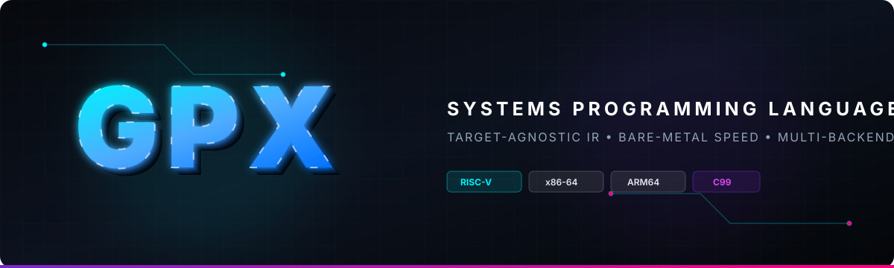

```text
              ______________________      ______________________         ______                ______
            ________________________     ________________________        ______              ______
          ______              ______    ______             ______        ______            ______
        ______                         _____               ______         ______        ______
       _____                          _____               ______           ______    ______
      _____          ____________    ________________________               ____________
     _____         ______________   ______________________                 ____________
    _____                 ______   _____                                ______    ______
   _____                 ______   _____                              ______        ______
   ______              ______    _____                            ______            ______
   ________________________     _____                           ______              ______
   ______________________      _____                          ______                ______
```
<p align="center">
  
</p>

<h1 align="center">GPX - Guided Programming eXperience</h1>

<p align="center">
  <b>A High-Performance, Multi-Backend Compiler with Bare-Metal Speed &amp; Target-Agnostic IR</b><br>
  <i>Engineered by <b><a href="https://github.com/nishit0072e">Nishit (@nishit0072e)</a></b></i>
</p>

<p align="center">
  <a href="https://github.com/nishit0072e/gpx-lang/releases"></a>
  <a href="LICENSE"></a>
  
  
</p>

<p align="center">
  <a href="https://github.com/nishit0072e/gpx-lang/actions/workflows/docs.yml"></a>
  
  
  
  
</p>

<p align="center">
  <a href="#overview">Overview</a> •
  <a href="#the-vision">Vision</a> •
  <a href="#architecture-pipeline">Architecture</a> •
  <a href="#installation--getting-started">Installation</a> •
  <a href="#compiler-cli-usage">CLI Usage</a> •
  <a href="#repository-structure">Project Structure</a> •
  <a href="#documentation">Documentation</a> •
  <a href="#ownership--intellectual-property">License</a>
</p>


<a id="the-vision"></a>
> ### 💡 The Founder's Keynote
> *"Most people look at compilers and see cold, impenetrable black boxes. We looked at them and asked an audacious question: What if compiling code wasn't a chore, but an exhilarating journey of discovery? What if every developer could peek behind the curtain of modern silicon and feel the raw pulse of the machine?*
> 
> *GPX was not born out of a checklist. It was born out of an insatiable obsession with how code comes alive. It stands for the **Guided Programming eXperience** - because the future belongs to builders who dare to master the machine from first principles."*
> 
> - **Nishit (@nishit0072e)**, Creator & Lead Architect

---

## Overview

**GPX (Guided Programming eXperience)** is a modern, statically-typed systems language engineered for those who crave bare-metal speed without losing cognitive clarity. 

Every transformation in GPX — from tokenization and AST parsing to target-agnostic Three-Address Code (TAC) and bare-metal RISC-V assembly — is designed to be introspectable, predictable, and blindingly fast.

### Core Highlights
* 🧭 **The Guided Experience:** Full compiler transparency. Step through tokens (`--tokens`), inspect ASTs (`--ast`), trace intermediate representation (`--ir`), and observe compiler optimization passes (`--opt`) with single-flag simplicity.
* ⚡ **Zero-Overhead Runtime:** No garbage collection pauses, no hidden runtimes, and instant cold startups (~1ms).
* 🛡️ **Strict Static Safety:** Compile-time type checking, lexical block scoping, and explicit type annotations.
* 🧠 **Middle-End Optimization Engine:** Constant folding, algebraic simplification identities ($x \times 0 \rightarrow 0, x + 0 \rightarrow x$), and dead-code elimination (DCE).
* ⚙️ **Pluggable Backends:** Generates optimized C99 (leveraging GCC `-O2` optimizations) and bare-metal RISC-V RV32I assembly.
* 📦 **Tiny Footprint:** Produces compact standalone binaries (~40 KB) without bloated runtimes.

---

## Architecture Pipeline

```
              GPX Source Code (*.gpx)
                      │
                      ▼
              ┌───────────────┐
              │     Lexer     │  characters -> tokens
              └───────┬───────┘
                      │
                      ▼
              ┌───────────────┐
              │    Parser     │  tokens -> AST
              └───────┬───────┘
                      │
                      ▼
              ┌───────────────┐
              │   Semantic    │  type checking, scopes, symbol table
              │   Analysis    │
              └───────┬───────┘
                      │
                      ▼
              ┌───────────────┐
              │  Target-Free  │  3-address code intermediate representation
              │      IR       │
              └───────┬───────┘
                      │
                      ▼
              ┌───────────────┐
              │ Optimization  │  constant folding, algebraic simplification, DCE
              └───────┬───────┘
                      │
      ┌───────────────┼───────────────┬───────────────┬───────────────┐
      ▼               ▼               ▼               ▼               ▼
┌───────────┐   ┌───────────┐   ┌───────────┐   ┌───────────┐   ┌───────────┐
│  x86-64   │   │   ARM64   │   │  RISC-V   │   │WebAssembly│   │ C99 Emitter
│  Backend  │   │  Backend  │   │  Backend  │   │  Backend  │   │(Universal)│
└─────┬─────┘   └─────┬─────┘   └─────┬─────┘   └─────┬─────┘   └─────┬─────┘
      ▼               ▼               ▼               ▼               ▼
 Windows/Linux    Apple/Mobile     Embedded/      Web Browser/       Any C
   Binaries         Binaries         FPGA           Cloudflare      Compiler
```

---

## Installation & Getting Started

### Option 1: Standalone Binary (Recommended)
Download the pre-compiled standalone binary directly from the [GitHub Releases](https://github.com/nishit0072e/gpx-lang/releases) page:
* **Windows:** Download **`gpx.exe`**.
* **Linux (x86-64):** Download **`gpx`** (run `chmod +x gpx`).

Add the binary to your system `PATH` and verify:
```bash
gpx --version
gpx --help
```

### Option 2: Universal Wheel Package
For machines with Python 3.10+:
```bash
pip install https://github.com/nishit0072e/gpx-lang/releases/download/v0.9.0/gpx_compiler-0.9.0-py3-none-any.whl
```

---

## Compiler CLI Usage

```bash
# 1. Run program directly in the VM (instant execution, zero binary created)
gpx examples/13_beginner_friendly_syntax.gpx --run

# 2. Compile to a Native Windows Executable (.exe)
gpx examples/03_fibonacci.gpx -o fib.exe
.\fib.exe

# 3. Launch the Integrated Language Server (LSP) for VS Code / Editors
gpx --lsp

# 4. Compile to Executable AND preserve intermediate C code
gpx examples/03_fibonacci.gpx -o fib.exe --save-c

# 5. End-to-end Pipeline Diagnostics & Stage Inspection
gpx examples/03_fibonacci.gpx --inspect

# 6. Emit Bare-Metal RISC-V RV32I Assembly
gpx examples/03_fibonacci.gpx --target riscv --emit

# 7. Compile to Standalone WebAssembly (.wasm) and Run via Node.js
gpx examples/44_webassembly_demo.gpx --target wasm -o demo.wasm
gpx examples/44_webassembly_demo.gpx --target wasm --run

# 8. Type Check without Compiling
gpx examples/03_fibonacci.gpx --check

# 9. View Intermediate Representation (TAC) with Optimizations
gpx examples/01_arithmetic.gpx --ir --opt
```

---

## Repository Structure

```
gpx-lang/
├── .github/
│   └── workflows/docs.yml     # Automated LaTeX multi-pass PDF docs builder
├── assets/
│   └── gpx-logo.svg           # 3D text branding banner
├── docs/
│   ├── gpx-specification.tex  # Comprehensive formal language & architecture manual (LaTeX)
│   ├── language-spec.md       # Formal EBNF grammar, types & memory model
│   ├── cli-guide.md           # CLI commands, flags, and testing guide
│   ├── repl-guide.md          # Interactive REPL, audio synthesizer, and DAP debugger
│   └── language-comparison.md # Performance & architecture vs C, Rust, Go, Zig
├── examples/
│   ├── 01_arithmetic.gpx      # Arithmetic and variable expressions
│   ├── 02_control_flow.gpx    # Conditionals (if/else) and while loops
│   ├── 03_fibonacci.gpx       # Functions and recursion
│   ├── 04_legacy_types.gpx    # Integer primitives (byte, short, int, long)
│   ├── 05_floating_and_printf.gpx # Floats, doubles, and formatted printf
│   ├── 06_structs_unions_loops.gpx # Structs, unions, and loop variants
│   ├── 07_pointers_and_recursion.gpx # Pointers (&, *), indirect member access (->)
│   ├── 08_fixed_size_arrays.gpx # Fixed-size arrays [T; N] and indexing
│   ├── 09_strings_and_text.gpx  # String library header (<string.gpx>)
│   ├── 10_dynamic_memory_and_structures.gpx # Dynamic memory (<memory.gpx>) and heap structs
│   ├── 11_file_io_and_casts.gpx # File I/O (<io.gpx>) and explicit casting ('as')
│   ├── 12_systems_enums_and_math.gpx # Bitwise ops, enums, switch, and math (<math.gpx>)
│   ├── 13_beginner_friendly_syntax.gpx # Friendly scripting, repeat loops, 2D turtle graphics (<draw.gpx>)
│   ├── 14_sound_synth_audio.gpx # 8-bit sound synthesis, square/sine waves, notes (<sound.gpx>)
│   ├── 15_oop_methods_geometry.gpx # OOP struct receiver methods (Point.distance_to, etc.)
│   ├── 16_dsa_vectors_lists.gpx # Dynamic array vector / list standard library (<list.gpx>)
│   ├── 17_dsa_hashmap_lookup.gpx # Hash table dictionary standard library (<hashmap.gpx>)
│   ├── 18_dsa_binary_search_tree.gpx # Binary search tree standard library (<tree.gpx>)
│   ├── 19_dsa_graph_traversal.gpx # Graph adjacency list traversal (<graph.gpx>)
│   ├── 41_module_math.gpx     # Reusable math module for multi-file imports
│   ├── 42_module_geometry.gpx # Reusable geometry module with structs & receiver methods
│   ├── 43_modules_main.gpx    # Multi-file module import system showcase (import ... as ...)
│   ├── 44_webassembly_demo.gpx # WebAssembly WASM & WAT target showcase (runs in browser/Node.js)
│   └── 45_generics_showcase.gpx # Generics, parametric polymorphism & monomorphization showcase
├── include/                   # Standard library headers (io, string, memory, math, sound, list, hashmap, etc.)
├── editors/                   # Official IDE extensions (VSIX for VS Code / Antigravity)
├── LICENSE                    # Proprietary copyright license
└── README.md                  # Quickstart & documentation
```

---

* 📘 [`docs/gpx-specification.tex`](docs/gpx-specification.tex): Formal language specification and reference manual (automatically compiled to PDF by GitHub Actions).
* 📖 [`docs/language-spec.md`](docs/language-spec.md): Complete EBNF grammar, types, scoping rules, and memory model.
* 🛠️ [`docs/cli-guide.md`](docs/cli-guide.md): Complete CLI reference, testing, debugging (`--inspect`), and code generation guide.
* 💻 [`docs/repl-guide.md`](docs/repl-guide.md): Interactive REPL guide, audio synthesizer commands, and Real-Time Memory Inspector (`--step`).
* ⚖️ [`docs/language-comparison.md`](docs/language-comparison.md): Comprehensive analysis comparing GPX against C, Rust, Go, and Zig across speed, memory, and scaling.

---

## Ownership & Intellectual Property

**Copyright (c) 2026 Nishit. All rights reserved.**  
All language design, specifications, architecture, and implementations are the proprietary intellectual property of the author. See [`LICENSE`](LICENSE) for terms.
